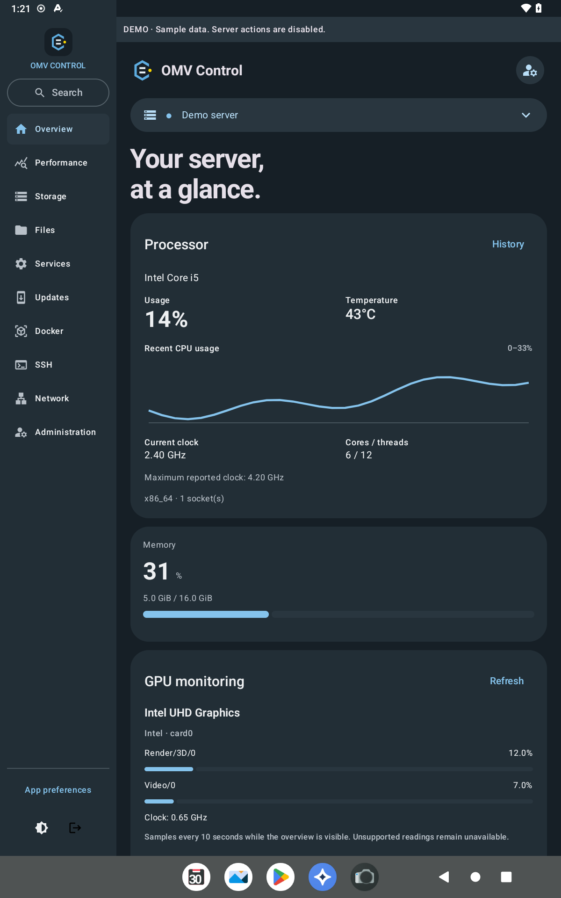
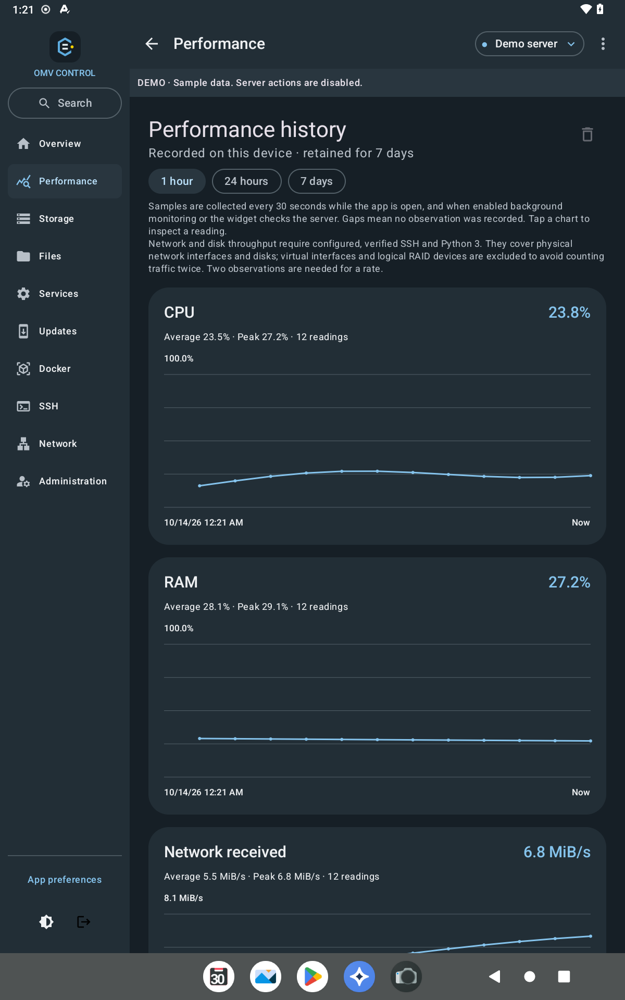
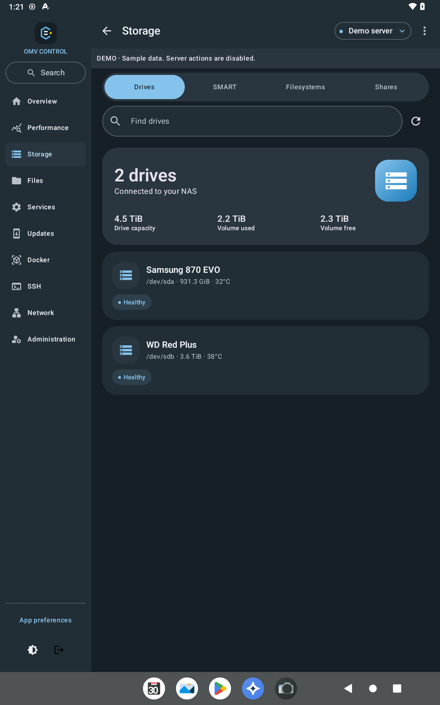
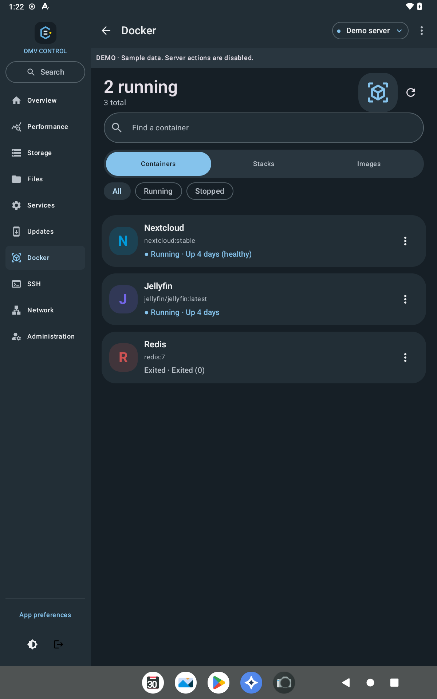
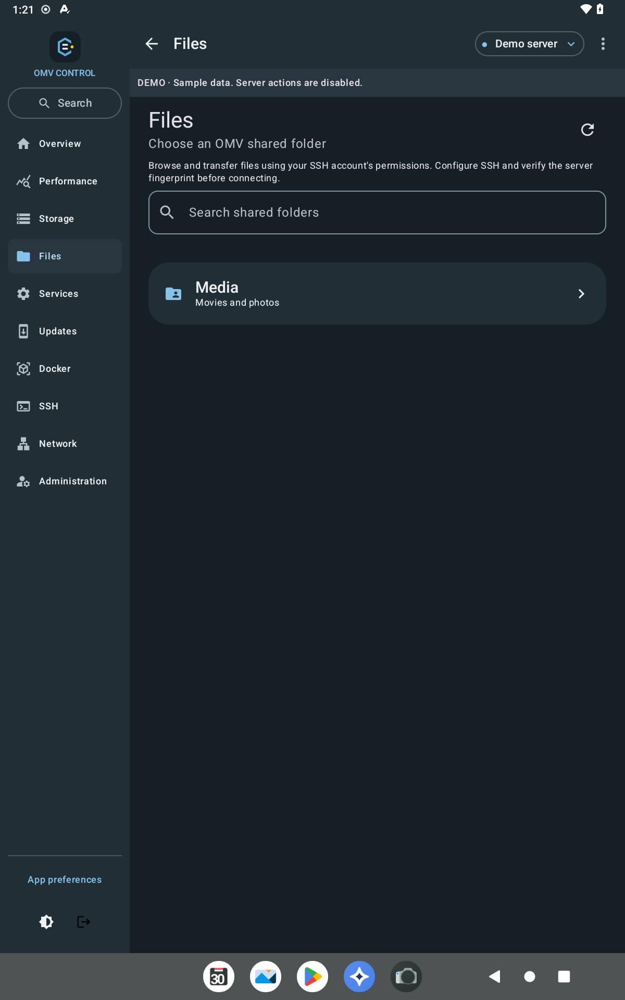
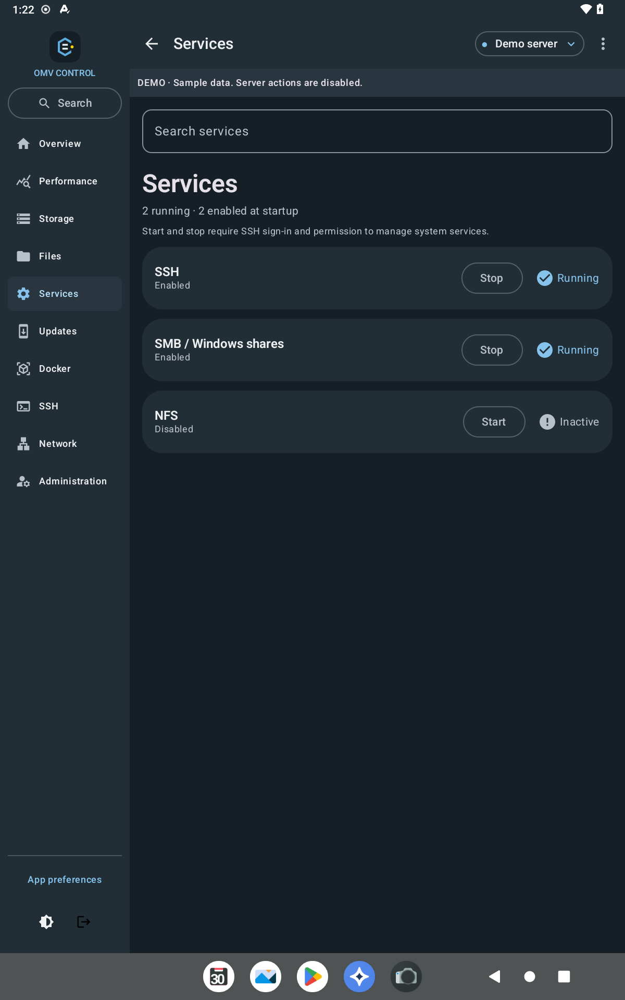
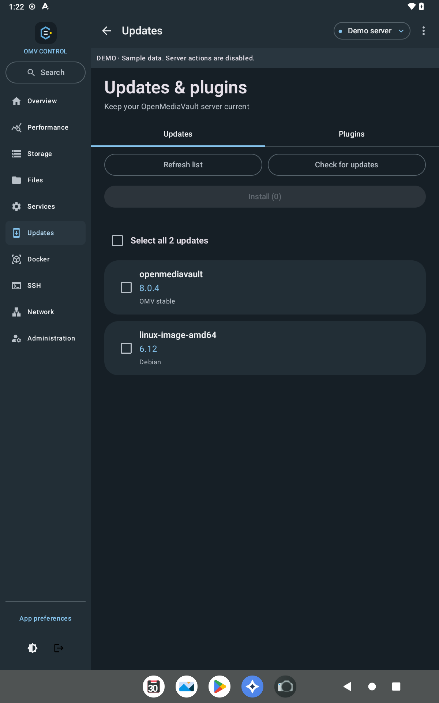
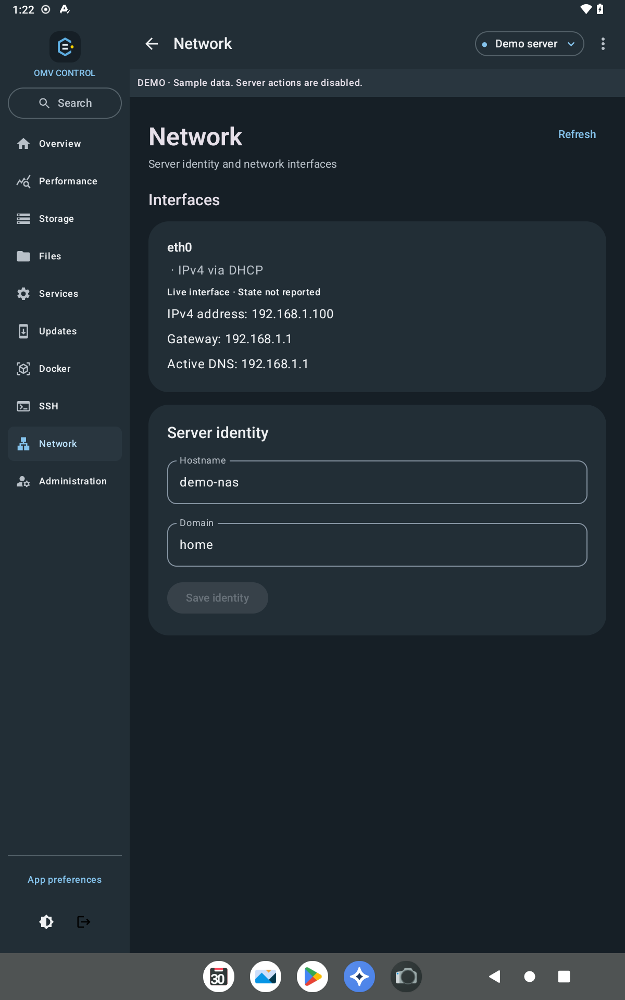
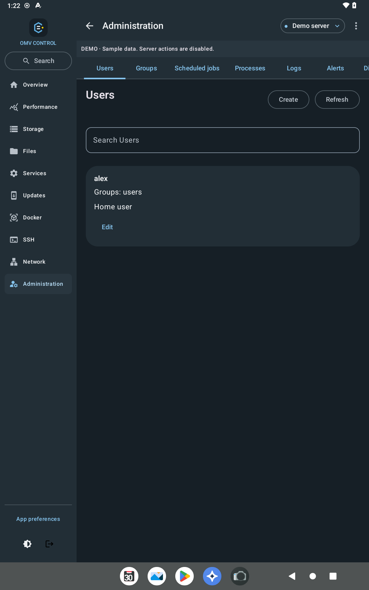

# OMV Control

An Android companion app for managing an [openmediavault](https://www.openmediavault.org/) NAS from your phone or tablet.

> **Unofficial.** This project is not affiliated with, endorsed by, or supported by the openmediavault project.

## Screenshots

Tablet, dark theme, built-in demo mode (sample data).

| Overview | Performance | Storage |
|---|---|---|
|  |  |  |

| Docker | Files | Services |
|---|---|---|
|  |  |  |

| Updates & plugins | Network | Administration |
|---|---|---|
|  |  |  |

## Features

- **Dashboard** — CPU, memory, temperatures, uptime and storage at a glance; cards can be hidden and reordered.
- **Storage** — file systems, disks, SMART health, attributes and self-test logs, shared folders.
- **Docker** — containers, OMV Compose stacks (up / stop / restart), images and update availability; a container editor for environment variables, ports, mounts and restart policy, with automatic backup and rollback.
- **Files** — browse shared folders over SFTP; upload, download (including whole folders as ZIP), rename, create and delete.
- **Services, updates and plugins** — service status and start/stop, package updates, installed plugins.
- **Administration** — users, groups, scheduled jobs, processes and system logs.
- **Performance** — CPU, RAM, network, disk and temperature charts (1 h / 24 h / 7 d).
- **SSH** — command runner with an OMV command library and an interactive shell.
- **Monitoring** — optional background checks with notifications for full disks, SMART problems, high temperatures, stopped services and containers, and available updates; home-screen widget.
- **Demo mode** — try the app without a server.

## Requirements

- Android 8.0 or newer.
- openmediavault 7 or newer, reachable from the device (LAN, VPN or reverse proxy).
- Optional, for some features:
  - **SSH access** for service controls, files, hardware details, network/disk rates and the container editor.
  - **Python 3** on the server for performance, hardware and container-editing helpers.
  - **openmediavault-compose** plugin for Docker features.

## Install

1. Download the latest `.apk` from [Releases](../../releases).
2. Open it on your device and allow installing apps from that source when Android asks.
3. Updates: install the newer APK over the old one; your saved servers are kept.
   You can also use [Obtainium](https://github.com/ImranR98/Obtainium) to get update notifications from this repository.

Every release is signed with the same key. The signing certificate SHA-256 is:

```
F4:CB:3F:60:C2:28:28:10:C5:3B:13:B7:92:FA:ED:0F:0F:A6:DE:69:76:3C:7A:87:66:A8:45:09:8F:5F:CA:AD
```

## Security

- Passwords are encrypted on the device with a key held in the Android Keystore; nothing is sent anywhere except to your own server.
- HTTPS is used by default. Self-signed certificates are trusted only after you approve that exact certificate, and a changed certificate is reported as a warning. Unencrypted HTTP must be explicitly allowed per server.
- SSH host keys are verified by fingerprint before any password is sent.
- Optional biometric app lock; app content is hidden from screenshots and the recent-apps screen by default.
- No analytics, no ads, no third-party services.

Use a **non-root SSH account** where possible (sudo rights for `systemctl`, membership in the `docker` group for container editing).

Found a security problem? Please open a private [security advisory](../../security/advisories/new) instead of a public issue.

## Building from source

Requires Android Studio (or JDK 17+ and the Android SDK).

```bash
./gradlew testDebugUnitTest      # unit tests
./gradlew assembleDebug          # debug build (package com.omvcompanion.app.dev)
./gradlew assembleRelease        # release build (needs a signing key, see below)
```

Release signing reads `keystore.properties` in the project root; copy `keystore.properties.example` and fill it in. Never commit that file or your keystore.

## License

[GPL-3.0](LICENSE). "openmediavault" is a trademark of its respective owners and is used here only to describe compatibility.
